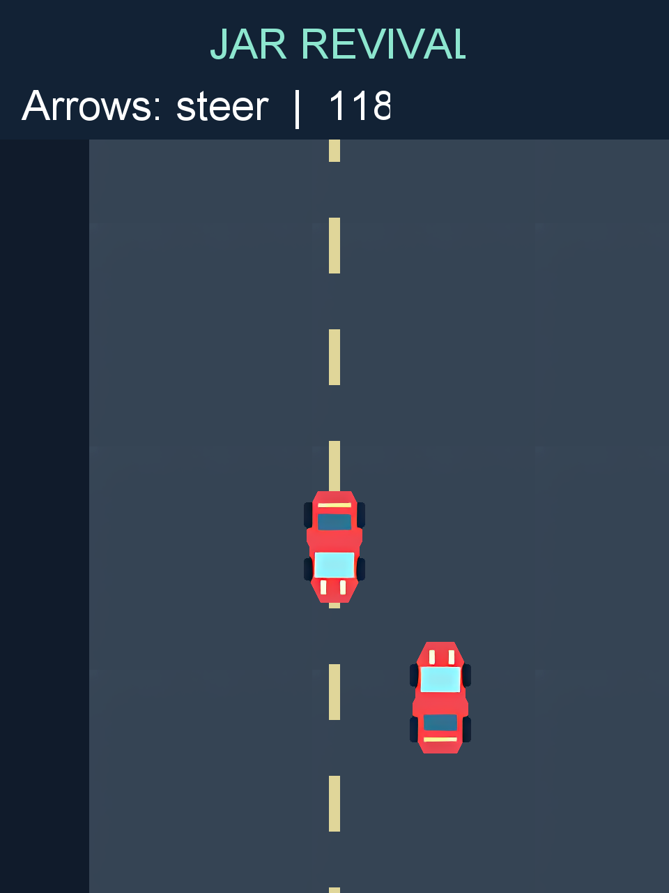
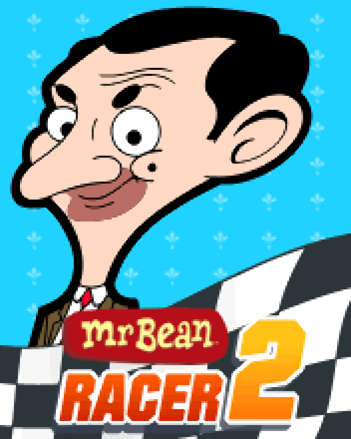
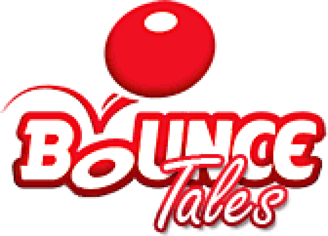
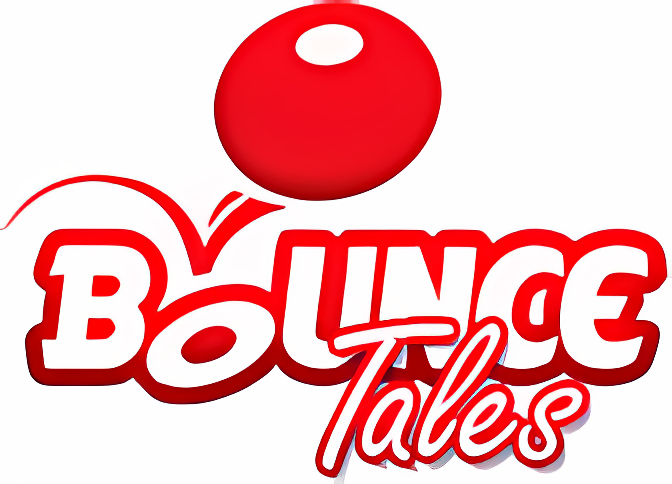

# JAR Revival

**Play classic Java ME phone games on Windows, with locally enhanced artwork and a desktop-sized view.**

JAR Revival imports your own J2ME games into a persistent library. It runs them with [FreeJ2ME-Plus](https://github.com/TASEmulators/freej2me-plus), prepares supported images with a local pixel scaler or optional Real-ESRGAN AI, and presents the game at desktop height while keeping its original proportions and logic.

  
   <em>Included synthetic demo; no game JAR is bundled.</em>

## Real-game artwork: Mr Bean Racer 2

This is the same 176 × 220 title image from a local MrBeanRacer2 import, shown at 4× (704 × 880). The original uses nearest-neighbor enlargement; the other panels are the saved Fast Pixel and Real-ESRGAN AI Cartoon outputs from this project. This is extracted title artwork, not a gameplay frame.

<table>
  <thead>
    <tr>
      <th>Original · nearest-neighbor 4×</th>
      <th>Fast Pixel · 4×</th>
      <th>AI Cartoon · 4×</th>
    </tr>
  </thead>
  <tbody>
    <tr>
      <td></td>
      <td></td>
      <td></td>
    </tr>
  </tbody>
</table>

<em>The MrBeanRacer2 JAR is not bundled; this comparison includes its title artwork. AI redraws the face and lettering, so the larger image is not a fully faithful restoration.</em>

## Bounce Tales artwork

This is the same 168 × 121 logo image from a local Bounce Tales import, shown at 4× (672 × 484). The first panel enlarges the original with nearest-neighbor sampling; the others show Fast Pixel and the locally generated Real-ESRGAN AI Cartoon output.

<table>
  <thead>
    <tr>
      <th>Original · nearest-neighbor 4×</th>
      <th>Fast Pixel · 4×</th>
      <th>AI Cartoon · 4×</th>
    </tr>
  </thead>
  <tbody>
    <tr>
      <td></td>
      <td></td>
      <td></td>
    </tr>
  </tbody>
</table>

<em>The Bounce Tales JAR is not bundled; the images show one extracted logo resource, not gameplay. AI visibly redraws the ball and lettering, so inspect details before choosing this style for a game.</em>

## What you can do

- Import JARs and keep a searchable local library with saved artwork and game data.
- Prepare supported 2D artwork with **Fast Pixel** or optional local **AI Cartoon**. Results are cached and reused.
- Play in a desktop-sized, aspect-preserving window with keyboard controls and a CPU compatibility option.
- Compare enhanced presentation with the original and keep the source JAR unchanged.
- Run enhancement locally; game files and artwork are not uploaded.

## Try it on Windows

For the portable Windows ZIP, extract the entire folder and open **JAR Revival.exe**. **README.txt** sits beside the app and gives the demo, AI setup, and upgrade steps. Support files are in `app/`; saves, settings, artwork, and downloaded AI are in `data/`.

To run from source, you need Windows 10 or 11, Python 3.10+ with Tkinter, a JDK 17+ with `javac` and `jlink`, and Git. The first build downloads the pinned emulator source and graphics libraries.

~~~powershell
py -m venv .venv
.\.venv\Scripts\python.exe -m pip install -r requirements.txt
.\.venv\Scripts\python.exe tools/build.py
.\.venv\Scripts\python.exe app.py
~~~

After launching, click **Import demo** in the sidebar to add the included synthetic game to your library; it does not appear there automatically. To use your own game, click **Add game** and choose a JAR you have the right to use. The demo exercises the player without bundling a commercial title and is not evidence of broad compatibility.

### Optional AI Cartoon

**Fast Pixel** works immediately and offline. AI Cartoon's runtime and model are not included in the portable ZIP. The first AI setup needs an internet connection and downloads the free Real-ESRGAN runtime and model into `data/tools/ai` in the portable app, or `tools/ai` in a source checkout. Game files and artwork stay local.

- In the portable Windows app, open the **Artwork** tab, click **AI setup**, and wait for the status to say that local AI is installed.
- In a source checkout, run `tools/setup_ai.py` after building the player.
- Then choose **AI cartoon** in the Artwork style selector. For a game already in your library, select it and click **Prepare**. For a new game, choose the style before clicking **Add game** or **Import demo**.

AI Cartoon requires a working Vulkan-capable graphics driver. Fast Pixel does not.

1. Choose an artwork style and select or import a game.
2. Wait for its import or preparation to finish, then choose **Play enhanced**. Controls appear in the player window.

## What to expect

This is an experimental project. Standard images and some recognized containers can be prepared before play. Some games store graphics in private formats, so only part of their artwork may be enhanced. Runtime discovery can find some additional stable images, but it does not promise full-game coverage.

AI enhancement can change small details, text, faces, or logos. Animation timing and game logic remain original; this project does not interpolate frames or remaster 3D models. A successful import means a game can launch, not that every level, control, or drawing path has been verified.

Only import games you are allowed to use. A JAR contains executable Java code; the emulator is not a security sandbox.

## For contributors

- After building the player, create the portable ZIP with `python tools/package_windows.py` (requires PyInstaller 6.22.3). The ZIP and checksum are written to `build/windows-release/`.
- [Project flow and component responsibilities](docs/PROJECT_FLOW.md)
- [Asset decoding and runtime discovery](docs/ASSET_DECODING.md)
- [Development setup and verification](docs/DEVELOPMENT.md)
- [Performance measurements and limits](docs/PERFORMANCE.md)

The Python contract suite runs on Windows for pushes and pull requests. Focused emulator and graphics checks are described in the development guide; some require a built player, a graphics driver, or a user-provided game.

## License

JAR Revival is GPL-3.0-or-later. FreeJ2ME-Plus, downloaded libraries, the optional model, and the Java runtime have their own notices and terms. Review upstream terms before redistributing a packaged build. User-imported game JARs are not included.
