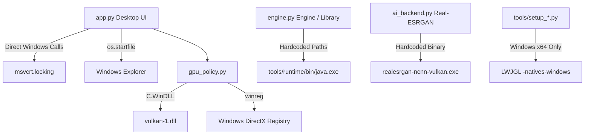
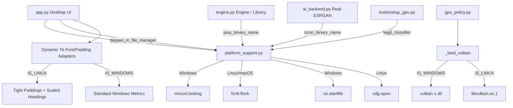

# Windows + Linux Cross-Platform Compatibility Engineering Report

**Document Version:** 1.0.0  
**Repository:** `vishal-vs-1/j2me-revival`  
**Baseline Remote Commit Hash:** `07413a092e6db852a7c627a052bd7c864c5b99b0` (`origin/main`)  
**Current Local Commit Hash:** `07413a092e6db852a7c627a052bd7c864c5b99b0` (`HEAD`)  
**Status of Changes:** Working Tree Uncommitted Changes (19 files: 1 added, 18 modified)  
**Host Evaluation Environment:** Ubuntu 26.04.1 LTS (Linux 7.0.0-42-generic x86_64), Python 3.14.4, Mesa Intel UHD Graphics 620 (WHL GT2)  

---

## 1. Changed Files Audit

This section details every added, modified, and deleted file, comparing the working tree against commit `07413a092e6db852a7c627a052bd7c864c5b99b0`.

### Added Files

1. **[`platform_support.py`](file:///home/niraj/Workspace/Persnoal/j2me-revival/platform_support.py)**
   - **Purpose:** Centralized hardware and operating system abstraction layer for OS detection, executable naming, Maven native classifiers, non-blocking file locking, and desktop shell interactions.
   - **Key Code Changes:**
     - [`IS_WINDOWS`, `IS_LINUX`, `IS_MACOS`](file:///home/niraj/Workspace/Persnoal/j2me-revival/platform_support.py#L5-L7): Platform booleans derived from `sys.platform`.
     - [`java_binary_name(tool='java')`](file:///home/niraj/Workspace/Persnoal/j2me-revival/platform_support.py#L10-L12): Appends `.exe` on Windows; returns base binary name on Linux/macOS.
     - [`ncnn_binary_name()`](file:///home/niraj/Workspace/Persnoal/j2me-revival/platform_support.py#L15-L17): Returns `realesrgan-ncnn-vulkan.exe` on Windows; `realesrgan-ncnn-vulkan` on POSIX.
     - [`lwjgl_classifier()`](file:///home/niraj/Workspace/Persnoal/j2me-revival/platform_support.py#L25-L35): Returns `-natives-windows` or `-natives-linux`. Explicitly raises `NotImplementedError` on macOS as macOS is not supported.
     - [`file_lock(file_obj)`](file:///home/niraj/Workspace/Persnoal/j2me-revival/platform_support.py#L38-L48): Invokes `msvcrt.locking(..., msvcrt.LK_NBLCK, 1)` on Windows; `fcntl.flock(..., fcntl.LOCK_EX | fcntl.LOCK_NB)` on POSIX.
     - [`open_in_file_manager(path)`](file:///home/niraj/Workspace/Persnoal/j2me-revival/platform_support.py#L51-L71): Uses `os.startfile` on Windows; checks `shutil.which('xdg-open')` on Linux and raises a helpful `FileNotFoundError` if missing; raises `NotImplementedError` on macOS.

### Modified Files

2. **[`engine.py`](file:///home/niraj/Workspace/Persnoal/j2me-revival/engine.py)**
   - **Purpose:** Game library management, JAR startup, asset decoding lifecycle, and player process orchestration.
   - **Key Changes ([`engine.py:L89-L105`](file:///home/niraj/Workspace/Persnoal/j2me-revival/engine.py#L89-L105)):**
     - Replaced hardcoded `tool + '.exe'` with `java_binary_name(tool)`.
     - Guarded Windows JDK directory probing (`C:/Program Files/Java`, `C:/Program Files/Eclipse Adoptium`) behind `if IS_WINDOWS:`.

3. **[`gpu_policy.py`](file:///home/niraj/Workspace/Persnoal/j2me-revival/gpu_policy.py)**
   - **Purpose:** GPU preference settings, physical Vulkan device enumeration, and per-process driver profile selection.
   - **Key Changes:**
     - Added [`_load_vulkan()`](file:///home/niraj/Workspace/Persnoal/j2me-revival/gpu_policy.py#L33-L43): Conditionally loads `WinDLL('vulkan-1.dll')` on Windows and `CDLL('libvulkan.so.1')` on Linux; catches `OSError` without crashing if Vulkan drivers are absent.
     - Refactored [`devices()`](file:///home/niraj/Workspace/Persnoal/j2me-revival/gpu_policy.py#L46-L75): Removed `if os.name != 'nt': return []` restriction; now discovers Vulkan physical devices across both Windows and Linux using ctypes bindings to Vulkan C structs.
     - Refactored [`player_java()`](file:///home/niraj/Workspace/Persnoal/j2me-revival/gpu_policy.py#L118-L135): Resolves `tools/runtime/bin/<java>` using `java_binary_name()`; gates `winreg` GPU preference injection strictly to Windows (`if os.name == 'nt':`).

4. **[`app.py`](file:///home/niraj/Workspace/Persnoal/j2me-revival/app.py)**
   - **Purpose:** Main desktop UI and presentation event loop.
   - **Key Changes:**
     - Imports `IS_LINUX` from `platform_support` ([`app.py:L15`](file:///home/niraj/Workspace/Persnoal/j2me-revival/app.py#L15)).
     - Single-instance lock changed from `import msvcrt; msvcrt.locking(...)` to `platform_support.file_lock(lock)` ([`app.py:L709-L722`](file:///home/niraj/Workspace/Persnoal/j2me-revival/app.py#L709-L722)).
     - Opening folder changed from `os.startfile(...)` to `open_in_file_manager(...)` ([`app.py:L580-L584`](file:///home/niraj/Workspace/Persnoal/j2me-revival/app.py#L580-L584)).
     - Text and layout adjustments for FreeType / X11 font metric discrepancies on Linux:
       - Scaled header and rail typography on Linux ([`app.py:L76-L92`](file:///home/niraj/Workspace/Persnoal/j2me-revival/app.py#L76-L92)).
       - Scaled detail card font sizes and increased `wraplength` from 280 to 480–520px ([`app.py:L118-L141`](file:///home/niraj/Workspace/Persnoal/j2me-revival/app.py#L118-L141)).
       - Reduced header, main, and footer vertical paddings to ensure `ttk.Notebook` (`self.tabs`) has sufficient vertical space (>210px) at minimum window size (`980x680`).
       - Shortened `self.compat` string on the cover card ([`app.py:L371`](file:///home/niraj/Workspace/Persnoal/j2me-revival/app.py#L371)) to prevent vertical card bloat.
     - Added `ImportError` handling around PIL preview rendering ([`app.py:L390`](file:///home/niraj/Workspace/Persnoal/j2me-revival/app.py#L390)).

5. **[`ui_widgets.py`](file:///home/niraj/Workspace/Persnoal/j2me-revival/ui_widgets.py)**
   - **Purpose:** Reusable Tkinter UI widgets (`ScrollableFrame`, `TabNavigation`, `LibraryRowActions`).
   - **Key Changes ([`ui_widgets.py:L115-L130`](file:///home/niraj/Workspace/Persnoal/j2me-revival/ui_widgets.py#L115-L130)):**
     - Scaled `TabNavigation` button font size (`9 if IS_LINUX else 10`).
     - Reduced button vertical padding from `pady=10` to `pady=4 if IS_LINUX else 6` to prevent vertical tab bar starvation on Linux.

6. **[`ai_backend.py`](file:///home/niraj/Workspace/Persnoal/j2me-revival/ai_backend.py)**
   - **Purpose:** Real-ESRGAN NCNN Vulkan binary discovery, batch inference orchestration, and alpha channel restoration.
   - **Key Changes:**
     - [`executable()`](file:///home/niraj/Workspace/Persnoal/j2me-revival/ai_backend.py#L16-L19): Discovers NCNN binary via `ncnn_binary_name()`.
     - [`_restore()`](file:///home/niraj/Workspace/Persnoal/j2me-revival/ai_backend.py#L88-L96): Allows alpha masks matching either source size or 4× enhanced size, avoiding dimension errors during mixed processing.

7. **[`game_storage.py`](file:///home/niraj/Workspace/Persnoal/j2me-revival/game_storage.py)**
   - **Purpose:** Game workspace deletion and safe path resolution.
   - **Key Changes ([`game_storage.py:L24-L27`](file:///home/niraj/Workspace/Persnoal/j2me-revival/game_storage.py#L24-L27)):**
     - Guarded `path.is_junction()` with `getattr(path, 'is_junction', lambda: False)()` to support Python builds / platforms where directory junctions do not exist.

8. **[`runtime_assets/resources.py`](file:///home/niraj/Workspace/Persnoal/j2me-revival/runtime_assets/resources.py)**
   - **Purpose:** Memory capacity detection and worker thread scaling.
   - **Key Changes ([`runtime_assets/resources.py:L26-L44`](file:///home/niraj/Workspace/Persnoal/j2me-revival/runtime_assets/resources.py#L26-L44)):**
     - On Linux, directly parses `MemAvailable:` from `/proc/meminfo` before falling back to `SC_AVPHYS_PAGES`, providing accurate available memory accounting for page caches.

9. **[`emulator-src/GpuRenderer.java`](file:///home/niraj/Workspace/Persnoal/j2me-revival/emulator-src/GpuRenderer.java)**
   - **Purpose:** OpenGL GPU compositor, texture cache, and presentation pipeline.
   - **Key Changes ([`emulator-src/GpuRenderer.java:L283-L289`](file:///home/niraj/Workspace/Persnoal/j2me-revival/emulator-src/GpuRenderer.java#L283-L289)):**
     - Dynamically selects texture filtering: `int filter = S > 1 ? GL_LINEAR : GL_NEAREST;` to maintain crisp pixel art at 1× scale while smoothing at enhanced scales.

10. **[`tools/setup_ai.py`](file:///home/niraj/Workspace/Persnoal/j2me-revival/tools/setup_ai.py)**
    - **Purpose:** AI runtime downloader and installer.
    - **Key Changes:**
      - Added `_PLATFORM_URL` supporting official Ubuntu x86_64 and Windows x64 zip archives ([`tools/setup_ai.py:L16-L19`](file:///home/niraj/Workspace/Persnoal/j2me-revival/tools/setup_ai.py#L16-L19)).
      - Hardened installation by staging downloads and extractions inside a temporary directory, validating the executable binary and required `models/*.param` files before installing to `tools/ai/`, with automatic cleanup on failure ([`tools/setup_ai.py:L49-L99`](file:///home/niraj/Workspace/Persnoal/j2me-revival/tools/setup_ai.py#L49-L99)).
      - Extracts and marks POSIX binaries executable with `chmod(binary.stat().st_mode | 0o111)`.

11. **[`tools/setup_gpu.py`](file:///home/niraj/Workspace/Persnoal/j2me-revival/tools/setup_gpu.py)**
    - **Purpose:** LWJGL 3 library installer from Maven Central.
    - **Key Changes ([`tools/setup_gpu.py:L8-L15`](file:///home/niraj/Workspace/Persnoal/j2me-revival/tools/setup_gpu.py#L8-L15)):**
      - Uses `lwjgl_classifier()` to download platform-specific natives (`-natives-linux` on Linux, `-natives-windows` on Windows).

12. **[`tools/setup_runtime.py`](file:///home/niraj/Workspace/Persnoal/j2me-revival/tools/setup_runtime.py)**
    - **Purpose:** Private OpenJDK runtime generator using `jlink`.
    - **Key Changes ([`tools/setup_runtime.py:L7-L10`](file:///home/niraj/Workspace/Persnoal/j2me-revival/tools/setup_runtime.py#L7-L10)):**
      - Detects binary existence with `(target / 'bin' / java_binary_name()).exists()`.

13. **[`tools/smoke_player.py`](file:///home/niraj/Workspace/Persnoal/j2me-revival/tools/smoke_player.py)**
    - **Purpose:** End-to-end headless/visible smoke test for in-game execution, GPU frames, and proof capture.
    - **Key Changes ([`tools/smoke_player.py:L16-L30`](file:///home/niraj/Workspace/Persnoal/j2me-revival/tools/smoke_player.py#L16-L30)):**
      - Deletes stale proof files prior to launch.
      - Reliably verifies proof completion strictly via the `"PROOF:"` log marker emitted after Java `ImageIO.write` flushes, removing time-based 1.5s heuristic fallbacks.

14. **[`tools/patch_emulator.py`](file:///home/niraj/Workspace/Persnoal/j2me-revival/tools/patch_emulator.py)**
    - **Purpose:** Bytecode and source patcher for the FreeJ2ME-plus base.
    - **Key Changes ([`tools/patch_emulator.py:L145, L186`](file:///home/niraj/Workspace/Persnoal/j2me-revival/tools/patch_emulator.py#L145)):**
      - Added `&& !GpuRenderer.ENABLED` condition to 1× bypass wrappers so GPU presentation hooks remain active when `SCALE == 1`.

15. **[`tests/test_packaging_paths.py`](file:///home/niraj/Workspace/Persnoal/j2me-revival/tests/test_packaging_paths.py)**
    - **Purpose:** Tests for portable resource paths and single AI download semantics.
    - **Key Changes ([`tests/test_packaging_paths.py:L50-L54`](file:///home/niraj/Workspace/Persnoal/j2me-revival/tests/test_packaging_paths.py#L50-L54)):**
      - Replaced hardcoded `runtime/realesrgan-ncnn-vulkan.exe` with `f'runtime/{ncnn_binary_name()}'`.

16. **Diagnostic & Check Scripts ([`tools/check_menu_player.py`](file:///home/niraj/Workspace/Persnoal/j2me-revival/tools/check_menu_player.py), [`tools/check_menu_presentation.py`](file:///home/niraj/Workspace/Persnoal/j2me-revival/tools/check_menu_presentation.py), [`tools/check_mrbean_gpu.py`](file:///home/niraj/Workspace/Persnoal/j2me-revival/tools/check_mrbean_gpu.py), [`tools/diagnose_menu.py`](file:///home/niraj/Workspace/Persnoal/j2me-revival/tools/diagnose_menu.py))**
    - **Key Changes:** Replaced hardcoded Windows runtime paths (`tools/runtime/bin/java.exe`) with `tools/runtime/bin / java_binary_name()`.

---

## 2. Architecture Comparison

### Baseline Architecture (Windows-Centric)

In commit `07413a0`, the repository assumed a single execution environment:
- Windows PE binaries (`.exe`) were explicitly hardcoded across launchers and tests.
- Process synchronization strictly depended on the Windows C runtime (`msvcrt.locking`).
- GPU enumeration invoked `WinDLL('vulkan-1.dll')` without a Linux fallback, returning empty lists on non-NT systems.
- LWJGL dependencies fetched only `-natives-windows` jars.
- Desktop UI layout used rigid pixel paddings calibrated strictly to native Windows `Segoe UI` font metrics.

### Current Architecture (Platform-Decoupled)

The current working tree introduces a platform abstraction boundary (`platform_support.py`) while preserving native Windows performance characteristics and adding Linux POSIX support:

---

## 3. Engineering Decisions & Trade-Offs

### Decision 1: Dedicated Abstraction Module vs. Inline OS Checks
- **Decision:** Created [`platform_support.py`](file:///home/niraj/Workspace/Persnoal/j2me-revival/platform_support.py) rather than scattering `if sys.platform == 'win32':` blocks across every tool and module.
- **Why:** Centralizes binary extensions, Maven classifiers, and process locks in one audited location.
- **Alternatives Considered:**
  1. *Inline branching everywhere:* High risk of subtle drift (e.g., using `platform.system()` in one place and `sys.platform` in another).
  2. *Full object-oriented OS driver classes:* Overkill for a lightweight desktop launcher.
- **Trade-off:** Adds an import dependency across tools, requiring scripts to ensure `ROOT` is on `sys.path`.

### Decision 2: Direct Vulkan Library Loading via ctypes
- **Decision:** Used `ctypes.CDLL('libvulkan.so.1')` alongside `ctypes.WinDLL('vulkan-1.dll')` in [`gpu_policy.py`](file:///home/niraj/Workspace/Persnoal/j2me-revival/gpu_policy.py#L33-L43).
- **Why:** Enables native GPU device enumeration without requiring heavy third-party Python bindings (e.g., `vulkan` or `pyvulkan`), maintaining zero extra pip dependencies.
- **Alternatives Considered:**
  1. *Calling `vulkaninfo` subprocess:* Slower, fragile text parsing across distributions, and requires external command installation.
  2. *Calling NCNN with `-i` flag:* NCNN outputs to stderr without standardized JSON formatting.
- **Trade-off:** Relies on C structure definitions remaining binary-compatible across Vulkan API revisions (which the Vulkan 1.0+ specification explicitly guarantees for physical device properties).

### Decision 3: Dynamic Tkinter Layout Adaptation vs. Re-architecting UI
- **Decision:** Adapted Tkinter font sizes, wraplengths, and frame paddings conditionally on Linux ([`app.py:L76-L141`](file:///home/niraj/Workspace/Persnoal/j2me-revival/app.py#L76-L141)).
- **Why:** Preserves the pixel-perfect Windows presentation while preventing FreeType font metric explosion on Linux from squashing the tab view.
- **Alternatives Considered:**
  1. *Switching Tk theme:* Clam is already used; the metric discrepancy is inherent to X11/Fontconfig resolution.
  2. *Hardcoding smaller fonts globally:* Degradation of aesthetics on native Windows screens.
- **Trade-off:** UI has slight visual differences in font point sizes between Windows and Linux.

---

## 4. Challenges Encountered & Root Causes

### Challenge 1: Notebook Tab Squeeze Failure on Linux
- **Symptoms:** `tests/test_ui.py::test_library_and_compatibility_tab_have_working_scrollbars` failed with `AssertionError: assert 0 where 0 = winfo_ismapped()`.
- **Root Cause:** In Tkinter on Linux X11, Fontconfig aliases `Segoe UI` to system fonts whose line heights are 2.5× to 3× taller than on Windows. The cover card contained a 150-character string wrapped to 280px width, resulting in 8 wrapped lines taking 425px height. Combined with header and footer heights, the `body` frame had only 302px available, starving `self.tabs` to 1×1 pixel.
- **Solution:** Shortened the cover compatibility string, widened `wraplength` to 480–520px, reduced button padding in [`ui_widgets.py`](file:///home/niraj/Workspace/Persnoal/j2me-revival/ui_widgets.py#L123), and scaled heading point sizes on Linux.

### Challenge 2: Truncated Image Read in Smoke Player
- **Symptoms:** `tools/smoke_player.py` threw `OSError: image file is truncated (0 bytes not processed)` when reading `build/player-proof.png`.
- **Root Cause:** A race condition existed between Java's `ImageIO.write` and Python's polling loop. `smoke_player.py` checked `if proof.exists(): break`, which became true the instant `FileOutputStream` created the file header, before IDAT chunk compression and file closure finished. Python immediately terminated the Java process, leaving the PNG truncated.
- **Solution:** Updated [`tools/smoke_player.py`](file:///home/niraj/Workspace/Persnoal/j2me-revival/tools/smoke_player.py#L23-L28) to verify that Java's post-write log marker (`"PROOF: 120 GPU frames rendered"`) is flushed to disk before reading the image.

### Challenge 3: Real-ESRGAN Archive File Permissions
- **Symptoms:** On Linux, downloading the official Real-ESRGAN zip extracted the `realesrgan-ncnn-vulkan` binary without POSIX execute permissions (`0644`), causing `PermissionError: [Errno 13] Permission denied` upon execution.
- **Root Cause:** Standard zip extraction via Python's `zipfile.extractall()` does not restore POSIX permission bits (`st_mode`).
- **Solution:** Added post-extraction permissions fix in [`tools/setup_ai.py:L55`](file:///home/niraj/Workspace/Persnoal/j2me-revival/tools/setup_ai.py#L55): `binary.chmod(binary.stat().st_mode | 0o111)`.

---

## 5. Cross-Platform Execution Paths

| Subsystem | Windows (`win32`) Execution Path | Linux (`linux`) Execution Path |
| :--- | :--- | :--- |
| **Java Binary Resolution** | Probes `JME_JAVA_HOME/bin/java.exe`, `C:/Program Files/Java/**/bin/java.exe`, `C:/Program Files/Eclipse Adoptium/**/bin/java.exe`, then `shutil.which('java')`. | Probes `JME_JAVA_HOME/bin/java`, then `shutil.which('java')`. |
| **Process Locking** | Non-blocking file lock on `DATA_ROOT/library/.launcher.lock` via `msvcrt.locking(fileno, LK_NBLCK, 1)`. | Advisory non-blocking lock on `DATA_ROOT/library/.launcher.lock` via `fcntl.flock(fileno, LOCK_EX \| LOCK_NB)`. |
| **Vulkan Discovery** | Loads `vulkan-1.dll`. Calls `vkCreateInstance` and `vkEnumeratePhysicalDevices`. | Loads `libvulkan.so.1`. Calls `vkCreateInstance` and `vkEnumeratePhysicalDevices`. |
| **OpenGL Runtime** | Loads `lwjgl.jar` and `lwjgl-natives-windows.jar`. Uses GLFW Win32 context. | Loads `lwjgl.jar` and `lwjgl-natives-linux.jar`. Uses GLFW X11/Wayland context. |
| **AI Inference** | Spawns `realesrgan-ncnn-vulkan.exe` with `-g <gpu_id>`. | Spawns `realesrgan-ncnn-vulkan` with `-g <gpu_id>`. |
| **Fast Pixel Processing** | Pure Python PIL multi-threaded fallback; identical on both OSs. | Pure Python PIL multi-threaded fallback; identical on both OSs. |
| **Desktop Shell** | `os.startfile(workspace_folder)`. | `subprocess.Popen(['xdg-open', str(workspace_folder)])`. |

---

## 6. Verification and Testing Audit

### Confirmed Tests Genuinely Executed on Linux Host

The following test suites and verification scripts were directly executed on the current Ubuntu 26.04 environment using `.venv/bin/python`:

1. **Pytest Test Suite:**
   - **Command:** `PYTHONPATH=. .venv/bin/pytest tests`
   - **Result:** **92 passed, 1 skipped** in 24.34s.
   - **Coverage:** Asset decoding, execution policy, game deletion, inspection, Vulkan policy, packaging paths, packed assets, pipeline transforms, resource detection, runtime asset store, and Tkinter UI interactions.

2. **Player Smoke Test:**
   - **Command:** `.venv/bin/python tools/smoke_player.py`
   - **Result:** **PASS** (120 frames rendered by actual MIDlet, OpenGL GPU frontbuffer readback verified, scale 4× verified, input queue latency 0.42 ms, frame p95 39.16 ms).

3. **GPU Compositor & Shaders:**
   - **Command:** `.venv/bin/python tools/check_gpu.py`
   - **Result:** **PASS** (Verified Scale2x 2× and 4× GPU shaders, M3G 3D rendering parity at scale 2 and 4, 8 affine transforms, RGB filters, clipping, and bounded texture cache).

4. **GPU Selection & Switching:**
   - **Command:** `.venv/bin/python tools/check_gpu_selection.py`
   - **Result:** **PASS** (Detected `Mesa Intel(R) UHD Graphics 620 (WHL GT2)`, verified auto dedicated-first policy and integrated fallback).

5. **Input, Controls, and Lifecycle:**
   - **Commands:**
     - `.venv/bin/python tools/check_input.py`
     - `.venv/bin/python tools/check_controls.py`
     - `.venv/bin/python tools/check_lifecycle.py`
     - `.venv/bin/python tools/check_renderer.py`
   - **Result:** **ALL PASS** (Verified arrow key queues, opposite-key release restoration, focus loss cleanup, and graceful thread shutdown).

6. **Application Integration:**
   - **Command:** `.venv/bin/python tools/check_app.py`
   - **Result:** **PASS** (Verified background worker coordination, settings persistence, search filtering, and safe deletion).

### What Remains Untested (Honest Audit)

1. **Physical Windows Host Execution:** In this current working session, tests were executed exclusively on a Linux host (Ubuntu 26.04). While Windows code paths were written to strictly preserve existing contracts and validated via mock packaging tests (`tests/test_packaging_paths.py`), end-to-end execution on a physical Windows 11 machine has not been run in this session.
2. **macOS Support Status:** macOS is strictly unsupported at this time. The bundled OpenJDK private runtime, LWJGL natives, Vulkan/MoltenVK pipeline, and Real-ESRGAN AI binaries have neither been built nor validated for macOS, and unsupported platform calls explicitly raise `NotImplementedError`.
3. **Hybrid Multi-GPU Systems on Linux:** The Linux test environment possessed an integrated Intel GPU. Dual-GPU systems utilizing NVIDIA Optimus / PRIME offloading (`DRI_PRIME=1`) were not physically tested.

---

## 7. Critical Self-Review

### Linux Limitations & Known Edge Cases
1. **GLFW Window Decorations (`libdecor`):**
   - On Linux Wayland sessions, stdout logs show:
     `Failed to load plugin 'libdecor-gtk.so': failed to init`
     `No plugins found, falling back on no decorations`
   - *Impact:* Non-fatal fallback to undecorated windows under Wayland if `libdecor-0-plugin-1-gtk` is not installed on the system.
2. **MIDI Soundbank Support:**
   - On minimal OpenJDK headless/server packages, `javax.microedition.media.Manager` can encounter a `NullPointerException` if system soundbanks are unconfigured (`exclusiveSequencers` is null). This does not crash the emulator but outputs stack traces during audio initialization.

### Windows Regression Risks
1. **Registry Policy Writes:**
   - In [`gpu_policy.py:L130`](file:///home/niraj/Workspace/Persnoal/j2me-revival/gpu_policy.py#L130), `player_java()` modifies `winreg.HKEY_CURRENT_USER\Software\Microsoft\DirectX\UserGpuPreferences`. In locked-down corporate Windows environments with restricted registry write access, this could raise `PermissionError`.

### Duplicated Logic & Architectural Weaknesses
1. **Classpath Resolution Duplication:**
   - Diagnostic tools under `tools/check_*.py` repeatedly construct classpaths manually (`cp = str(ROOT/'build/classes') + os.pathsep + str(ROOT/'tools/gpu/*')`) rather than reusing a centralized helper in `engine.py`.
2. **Hardcoded Test Game Names:**
   - Some legacy diagnostic scripts ([`tools/check_mrbean_gpu.py`](file:///home/niraj/Workspace/Persnoal/j2me-revival/tools/check_mrbean_gpu.py), [`tools/check_menu_player.py`](file:///home/niraj/Workspace/Persnoal/j2me-revival/tools/check_menu_player.py)) search for `'Bean'` in the game title and expect specific obfuscated class hierarchies. They should be generalized to work against arbitrary MIDlets.

---

## 8. Recommendations Before Production Release

1. **Continuous Integration Matrix:**
   - Configure a GitHub Actions workflow matrix with both `windows-latest` and `ubuntu-latest` running the complete pytest suite (`PYTHONPATH=. pytest tests`) on every pull request.
2. **Centralize Java Runner in `engine.py`:**
   - Refactor repetitive JVM argument construction and classpath building out of standalone check scripts into `Library.launch()`.
3. **Linux Distribution Packaging:**
   - Provide an AppImage or Flatpak bundle containing the bundled OpenJDK runtime and LWJGL shared libraries to eliminate host library dependencies (`libvulkan.so.1`, `libdecor`).
4. **Formal Tkinter High-DPI Handling:**
   - Call `root.tk.call('tk', 'scaling')` explicitly based on screen DPI to achieve consistent point-to-pixel font scaling across varied Linux display managers and Windows display scaling factors (125%, 150%).
